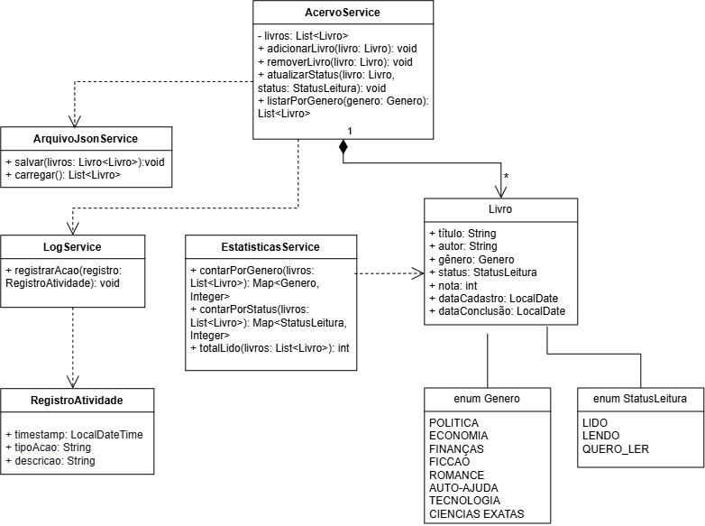
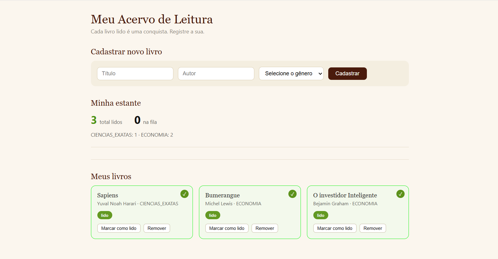
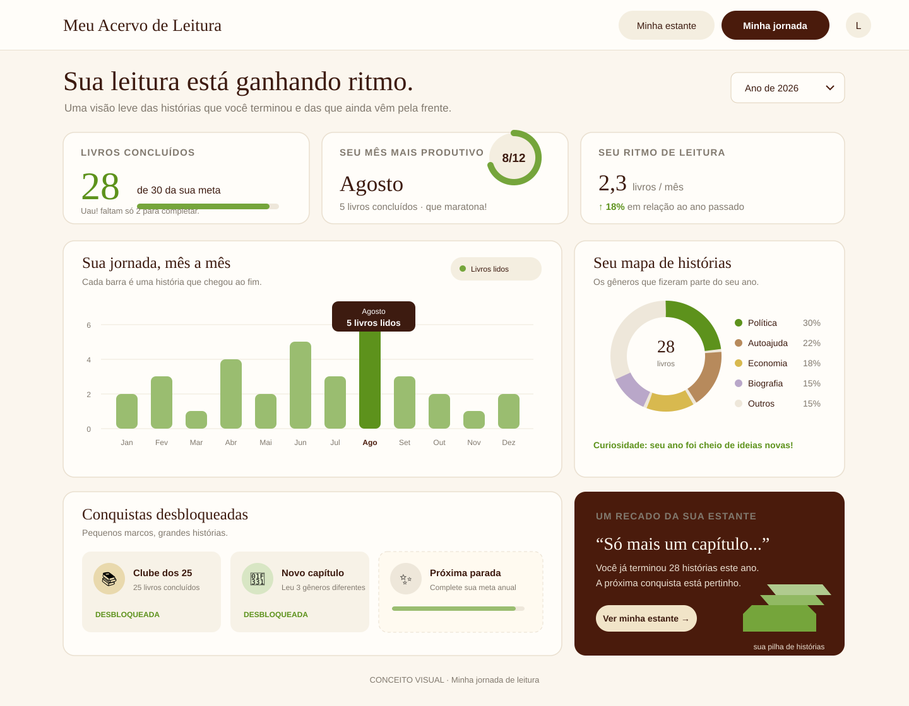

# Evolução do Meu Acervo de Leitura

Este documento registra como o projeto evoluiu da primeira modelagem até a versão atual. O objetivo é preservar o contexto das decisões e deixar claro quais documentos representam ideias iniciais e quais descrevem o sistema implementado.

## Situação atual

O projeto está concluído para seu objetivo atual: uma aplicação local e pessoal para registrar livros e acompanhar leituras. A versão em uso combina menu de terminal, API REST Java/Javalin e interface web. Os livros são persistidos em `data/livros.json`.

Não foram implementados deploy, contas de usuário ou banco de dados. Esses assuntos ficam como possibilidades futuras, caso o projeto passe a precisar de acesso remoto, múltiplos usuários ou sincronização entre dispositivos.

## Primeira versão e diagrama UML

O arquivo [`diagrama-uml.png`](diagrama-uml.png) registra a modelagem da **primeira versão** do projeto. Ele foi criado antes da evolução que acrescentou a API, a interface web com duas áreas (**Minha estante** e **Minha jornada**), o acompanhamento anual, a meta de leitura e o registro do mês/ano de conclusão.

Por isso, o diagrama é um documento histórico e não representa integralmente a arquitetura e as funcionalidades do estado atual. A implementação posterior ampliou o sistema e alterou partes do modelo. O diagrama pode ser atualizado em uma revisão futura; até lá, deve ser lido como retrato da versão inicial, não como especificação completa do código atual.

O [`mockup-minha-jornada.svg`](mockup-minha-jornada.svg) também é uma referência de design, não uma captura fiel do sistema final. Ele mostra a direção visual planejada para a jornada; os números são ilustrativos e alguns elementos do conceito não foram implementados exatamente como aparecem. A tela atual deve ser conferida em `frontend/index.html` e `frontend/style.css`.

## Evolução visual

As imagens abaixo registram momentos diferentes do projeto. A primeira é a modelagem inicial; a segunda é a primeira interface, ainda em uma única página. A versão atual separa a estante da jornada e está implementada no código do frontend.

### 1. Modelagem inicial — UML

Este diagrama documenta a estrutura pensada para a versão inicial. Como explicado acima, ele não foi atualizado para representar todas as mudanças posteriores.

### 2. Protótipo 1 — primeira interface

Esta captura registra a página única do primeiro protótipo, que reunia cadastro, estante e estatísticas na mesma tela.

### 3. Versão atual — estante e jornada

A implementação atual organiza a experiência em duas seções navegáveis: **Minha estante**, para cadastrar e gerenciar livros, e **Minha jornada**, para visualizar o resumo anual, gráficos, conquistas e meta. Consulte o [HTML da interface](../frontend/index.html), o [estilo visual](../frontend/style.css) e o [comportamento da interface](../frontend/script.js).

O mockup [`mockup-minha-jornada.svg`](mockup-minha-jornada.svg) ajuda a entender a direção visual da jornada, mas é um conceito e não uma captura da tela atual. As capturas acima são registros históricos; a versão funcional deve ser vista executando o projeto conforme as instruções do [README](../README.md).

## Etapas de evolução implementadas

### Etapa 1 — Estante e jornada

- A interface foi organizada em duas áreas: **Minha estante**, para cadastro e gerenciamento, e **Minha jornada**, para acompanhar o progresso.
- A jornada ganhou resumo anual, visualização mensal, distribuição por gênero, conquistas e mensagens de progresso.
- O cadastro passou a aceitar mês e ano de conclusão opcionais. Quando informados, o livro é registrado como lido sem exigir um dia específico.
- A interface recebeu ajustes responsivos e de acessibilidade, incluindo navegação por teclado e atalho para o conteúdo principal.

### Etapa 2 — Estatísticas anuais na API

- Foi adicionada a rota `GET /estatisticas/ano?ano=2026`.
- A resposta inclui o total concluído no ano, os doze totais mensais e a distribuição por gênero.
- A jornada consome os dados anuais da API, mantendo os resumos alinhados ao acervo persistido.

### Etapa 3 — Meta anual

- A pessoa pode definir e ajustar uma meta de livros para cada ano.
- A interface mostra progresso, percentual, quantidade restante ou a conclusão da meta.
- A meta é armazenada no navegador por ano, usando `localStorage`; por isso, não é sincronizada entre navegadores ou dispositivos.

### Etapa 4 — Revisão e testes

- Foram revisadas a navegação por teclado e a apresentação em telas menores.
- Os gráficos e atualizações de resumo receberam descrições e suporte a tecnologias assistivas.
- Foram adicionados testes para os cálculos anuais por mês e gênero, incluindo anos distintos, livros com outros status e meses sem leituras.
- A persistência JSON foi reforçada para tratar falhas de gravação sem deixar a memória do programa divergente do arquivo.

## Funcionalidades que compõem a versão atual

- Cadastro, listagem, remoção e mudança de status dos livros.
- Prevenção de títulos duplicados sem diferenciar maiúsculas e minúsculas.
- Registro do mês e ano em que a leitura foi concluída.
- Estatísticas gerais, mensais e anuais por gênero.
- Jornada visual com meta anual e conquistas calculadas a partir do acervo.
- Persistência local dos livros em JSON.
- Menu de terminal e interface web conectada à API REST.

## Limitações conhecidas e possíveis evoluções

- Não há autenticação nem separação de acervos por pessoa; o sistema foi feito para uso local e pessoal.
- O histórico de atividades existe somente durante a execução atual.
- A meta anual fica no navegador e não é compartilhada entre dispositivos.
- Os testes automatizados cobrem cálculos selecionados, mas ainda não cobrem todos os endpoints da API nem a persistência JSON.
- Uma futura migração para banco de dados pode ser planejada se houver necessidade, junto com a atualização do UML para refletir o modelo vigente.
